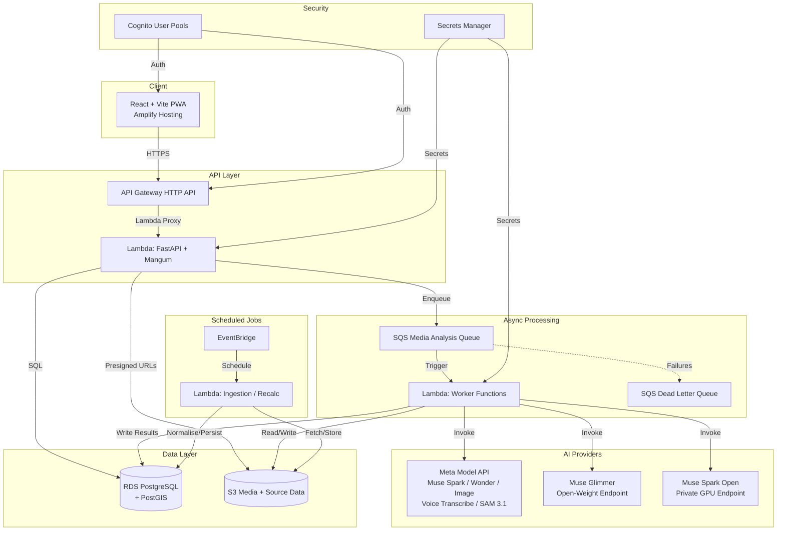
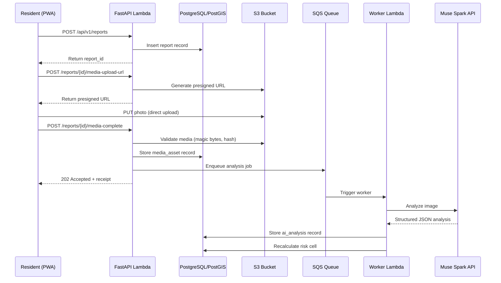
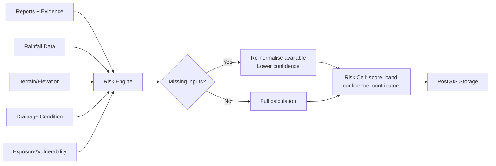

# FloodLens AI — Architecture

## Overview

FloodLens AI is a community-powered flood observation and risk mapping platform for African communities. The system combines community-submitted reports, environmental data, and AI-assisted analysis to produce explainable risk indicators on interactive maps.

## High-Level Architecture

## Data Flows

### Report Submission Flow

### Risk Calculation Flow

## Component Separation

| Layer | Technology | Responsibility |
|---|---|---|
| Frontend | React + TypeScript + Vite + Tailwind | UI, maps, offline drafts, PWA |
| API | FastAPI + Mangum (Lambda) | Request handling, validation, orchestration |
| Database | PostgreSQL + PostGIS | Spatial data, reports, risk cells, audit |
| Storage | S3 | Media, thumbnails, masks, source datasets |
| Queue | SQS | Async media analysis jobs |
| AI Providers | Meta API + Open-Weight Adapters | Image analysis, segmentation, voice, synthesis |
| Risk Engine | Python service | Configurable FRI calculation |
| Ingestion | Scheduled Lambda | Environmental data adapters |
| Auth | Cognito / role-based | Staff authentication, public anonymity |
| Secrets | Secrets Manager | API keys, DB credentials |
